  

  

 

> **僕は人間だ！** — *"Eu sou um humano!"*

Olá! Eu sou o **Gabriel Toledo**, estudante de **Análise e Desenvolvimento de Sistemas (ADS)**. 
Fã de **Tokyo Ghoul** (o Kaneki é o culpado pelo visual deste perfil), curto transformar café e prazo apertado em código.

- 🎓 Cursando **ADS**
- 🔭 Estudando: `edite aqui o que você está aprendendo agora`
- 🌱 Construindo: `edite aqui seu projeto atual`
- 🤝 Aberto a: `estágio · projetos open source · trocar ideia sobre código`
- ⚡ Curiosidade: `edite aqui`

  

 

  

  
  
  
  
  
  
  
  
  
  
  
  

  

 

  
  

  

  

 

  
  
  
  

  

<b>"Quando você está na escuridão, só afunda mais — então compile."</b> · feito com ☕ por Gabriel Toledo

